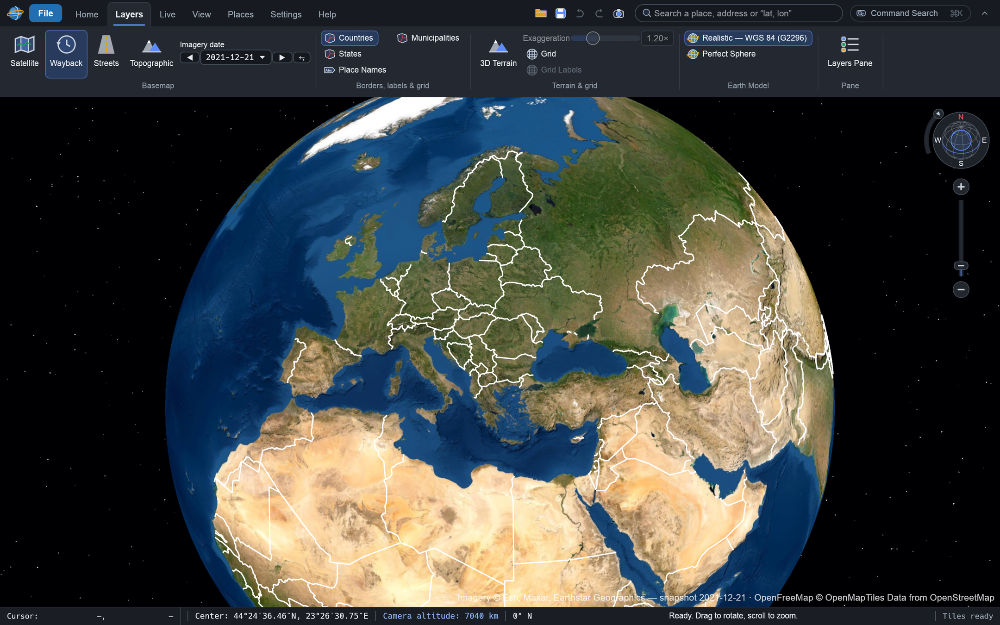

# GlobeCraft 🌍

**A small, fast 3D globe for your desktop.** Fly anywhere on Earth, look at satellite
imagery, borders and names, follow live aircraft, ships and weather, and measure
distances. Free and open source, for Windows, macOS and Linux.



## Get it

1. Open the [latest release](https://github.com/FireflyTheReal/GlobeCraft/releases/latest).
2. Download the file for your computer:
   - **Windows:** the `.msi` installer (or the portable `.zip`)
   - **Mac (Apple Silicon):** the `.dmg`. Drag GlobeCraft to Applications. The first
     time, macOS may block it: open it once, then choose **System Settings → Privacy &
     Security → Open Anyway**.
   - **Linux:** the `.AppImage`, or the `.deb` / `.rpm` / Flatpak / Snap package
3. Start GlobeCraft. It needs an internet connection to load maps.

GlobeCraft updates itself when a new release is out (you can turn this off in Settings).

## Use it

| To… | Do this |
| --- | --- |
| Turn the globe | Drag with the mouse, or use the arrow keys |
| Zoom | Mouse wheel, or `+` / `−` |
| Tilt or rotate the view | Right-drag, or Shift + drag |
| Fly to a place | Type it in the search box, or double-click the globe |
| Point north again | Press `N` |
| Find any command | `Ctrl/⌘ + K` (Command Search) |
| Ask in plain words | Open the **Assistant** pane (needs your own AI provider key) |

The tabs at the top hold everything else: **Layers** (borders, names, grid, terrain),
**Live** (aircraft, ships, satellites, rain radar, clouds, traffic), **Places**
(your placemarks and KML files), **View** and **Settings**.

## What it can do

- Satellite, street and topographic maps, historical imagery by date, and 3D terrain
- Country, state and municipal borders with names, streamed in as you zoom
- Live aircraft, ships, satellites, rain radar, clouds and traffic
- Placemarks and KML/KMZ files, a distance ruler, coordinates in many formats
- Real sunlight, atmosphere, stars, the Moon and your own planet images
- Screenshots without the interface, game controllers, English and Brazilian Portuguese

## Build it yourself

Install [Rust](https://rustup.rs) (1.95 or newer), then:

```sh
git clone https://github.com/FireflyTheReal/GlobeCraft
cd GlobeCraft
cargo run --release
```

On Linux you may first need `sudo apt install build-essential pkg-config libgtk-3-dev libxkbcommon-dev libwayland-dev libx11-dev`.

Developers: start with [the architecture](docs/ARCHITECTURE.md),
[CONTRIBUTING.md](CONTRIBUTING.md) and the [roadmap](docs/ROADMAP.md).

## Credits

GlobeCraft stands on open maps, data and code from many people and organisations:
Esri, OpenStreetMap contributors, OpenFreeMap, OpenMapTiles, OpenTopoMap,
Mapterhorn, NASA, Natural Earth, OpenSky Network, ADSB.lol, CelesTrak,
RainViewer and more. The full list, with licences, is in **[CREDITS.md](CREDITS.md)**.

Based on [EarthCraft](https://github.com/therichronicles/EarthCraft) by
@therichronicles and @PixelSoftwareStudios. The interface and AI assistant are adapted
from [RustGIS](https://github.com/opengeos/RustGIS) (Apache-2.0).

## Licence

MIT — see [LICENSE](LICENSE).
